# Paligraph Canvas

**灵感，落于笔尖。** A local-first notebook for ink, Markdown and the ideas in between.

[](https://github.com/whwdzg/Paligraph-Canvas/actions/workflows/deploy.yml)


Paligraph Canvas 是一个基于 Web 的笔记绘图软件：一张无限画布、一套接近 Apple Notes 的悬浮工具栏、Fluent Design Sun Valley 的材质，以及可选的液态玻璃（liquid glass）质感。它把笔迹数据和 Markdown 都留在这台设备上，并可以在需要时导出为 PDF 或 Markdown。

<p align="center">
  
</p>

| 深色 / 阅读卡片 | 笔刷选项 |
| --- | --- |
| 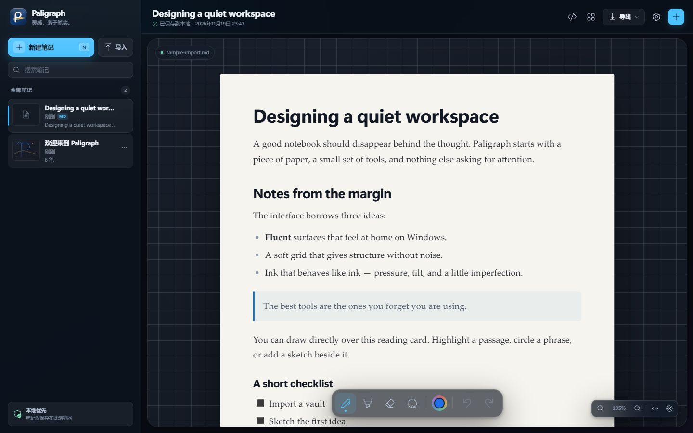 | 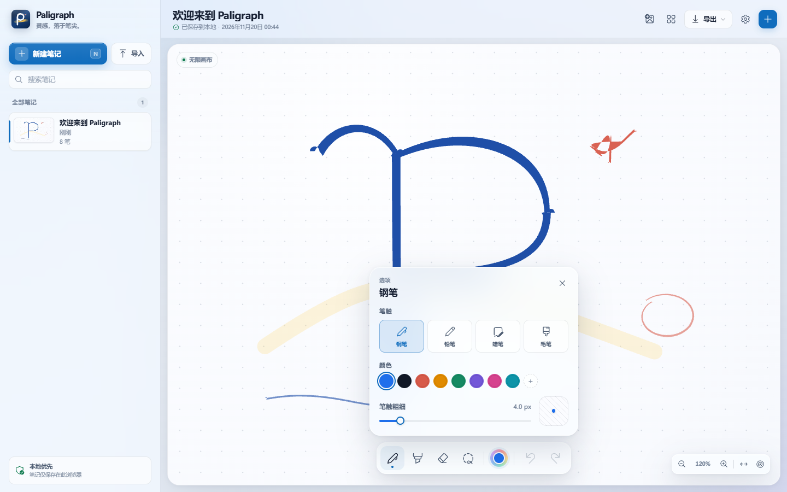 |

| 图形纠正 | 手写数学 |
| --- | --- |
| 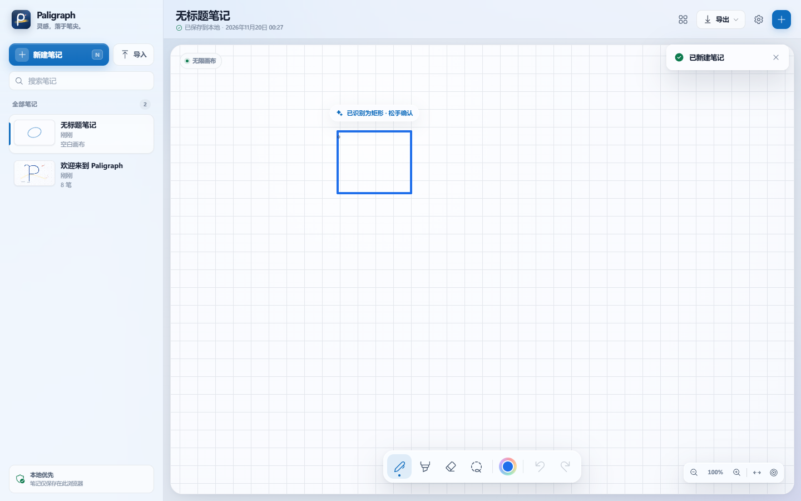 | 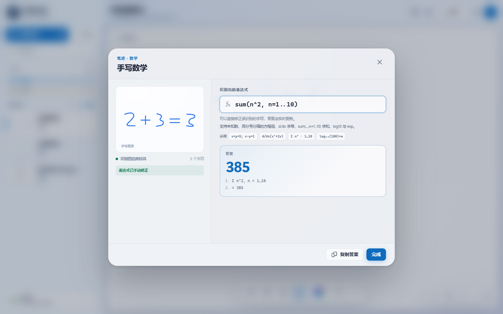 |
| 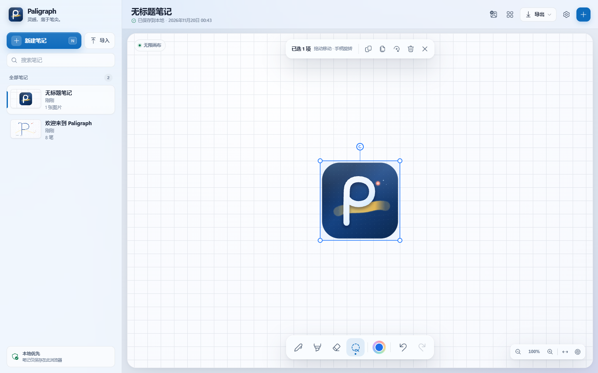 | 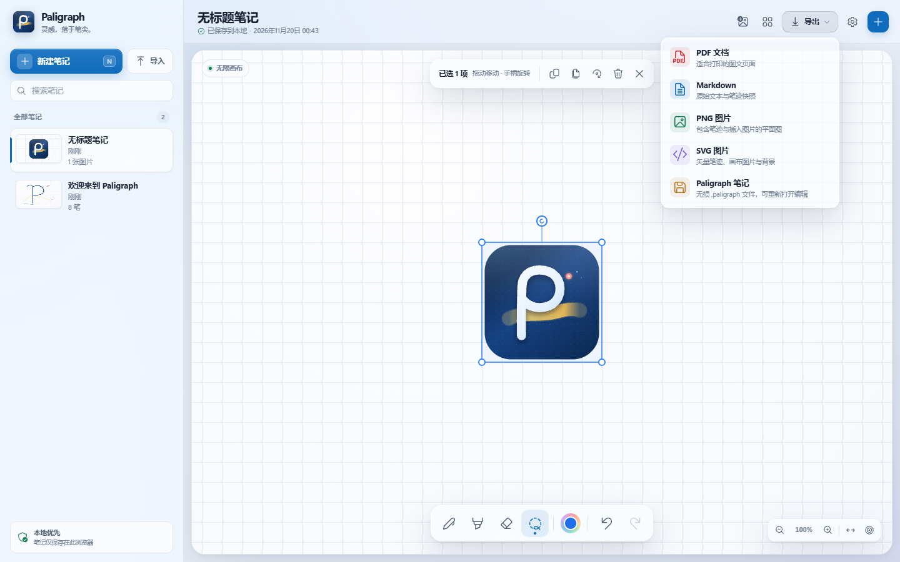 |
| 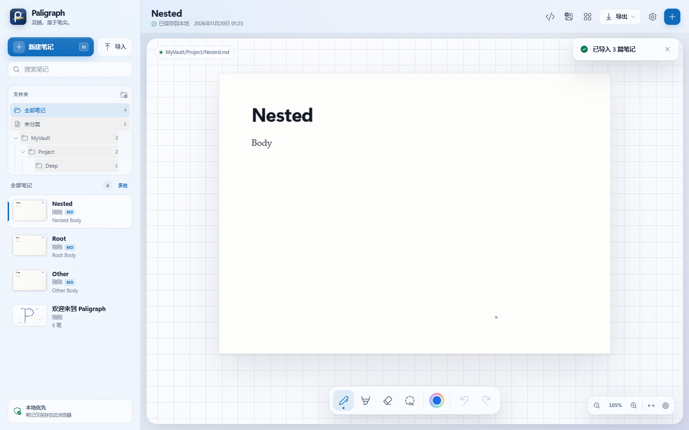 | 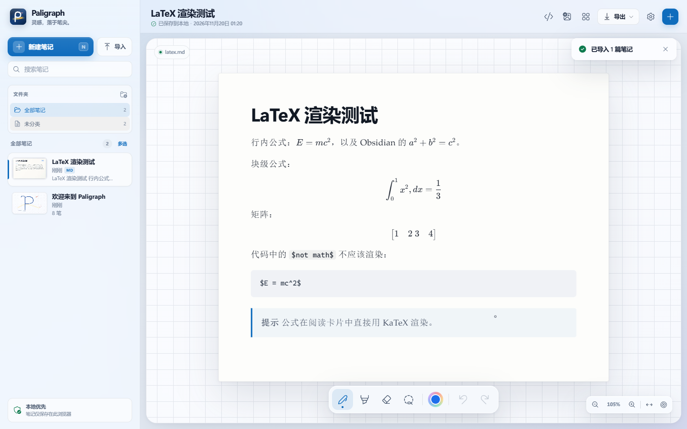 |
| 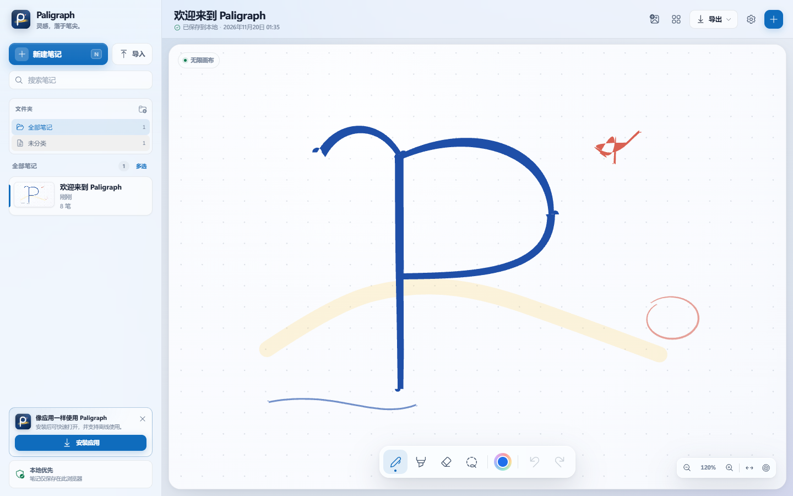 | 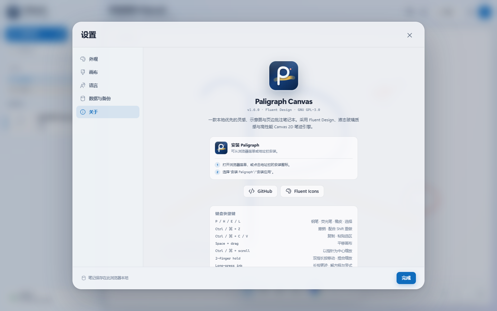 |

<p align="center">
  
</p>

---

## 功能

### 画布与笔

- 无限画布，世界坐标与视口缩放分离；平移或缩放时不会破坏绘制精度。
- 钢笔、铅笔、蜡笔、毛笔四种笔触，压感会改变线条粗细。
- 笔触渲染细节：压感双端平滑、两端自然收锋；钢笔带柔边和湿润墨芯，铅笔使用短石墨颗粒和纸纹点，蜡笔使用宽蜡带与碎蜡，毛笔使用纵向鬃毛、浅色高光和干笔缺口。
- 画笔选项中的预览使用与画布相同的 Canvas 渲染器，直接展示当前颜色、粗细和纹理。
- 荧光笔支持自由绘制与**直线**两种模式，颜色、宽度独立设置。
- **图形纠正**：画完直线、矩形、正方形、正圆、椭圆、三角形、正三角形、菱形、五角星、勾或叉后按住笔尖停留，松手时自动吸附为干净图形。
- **插入图形**：底部工具栏新增图形库，包含直线、箭头、矩形、正方形、椭圆、正圆、三角形、正三角形、菱形、五角星、五边形、六边形、勾、叉；悬浮面板使用圆角磨砂玻璃，插入后自动选中，可移动、旋转、缩放。
- **手写数学**：用套索选中笔迹后点击浮动工具条的数学按钮；支持未知数、方程组、求导、求和、对数、指数等高级运算，识别结果可修正并实时求解。
- 橡皮支持**按笔迹擦**（整条笔画）与**像素擦**（只擦除触及区域），也可以一键清空画布。
- 手写笔适配：Pointer Events 压感、合并事件、手掌防误触、笔杆侧键临时切换为橡皮。
- 双指**长按约 260 ms** 后移动可平移画布，捏合可缩放；快速双指触碰不会误移画布。
- 空格 + 拖动、鼠标中键、触控板滚动都可以移动画布；`Ctrl/⌘ + 滚轮`以指针为中心缩放。

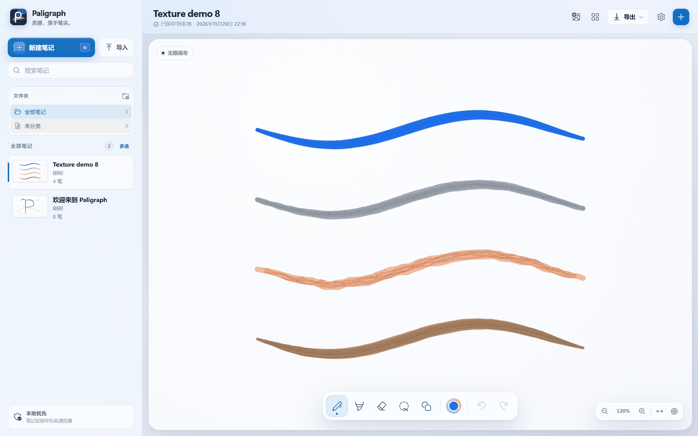

### 手写数学与高级运算

- **选择后识别**：用套索圈选公式笔迹，点击浮动工具条的数学按钮；不再依赖长按。
- 识别器支持数字、变量 `x/y/z/a/b/c/n/t`、四则运算、幂、括号、`Σ`、`π`、`√` 等常见符号。
- 求解对话框支持：
  - 一元一次方程与数值实根（包括二次、对数、指数方程）
  - 线性方程组，例如 `x+y=5; x-y=1`
  - 符号求导，例如 `d/dx(x^3+2x)`
  - 有限求和，例如 `sum(n^2,n=1..10)` 或 `Σ(n^2,n=1..10)`
  - 对数与指数，例如 `log10(100)+exp(1)`
  - 未知数表达式化简
- 对话框内置示例按钮，识别结构不完整时可以直接修正表达式。
- Math.js 计算引擎只随数学对话框按需加载，不影响首屏。


### 图形库与图形纠正

- 底部工具栏的图形按钮打开 14 种常用图形，点击即可放到画布中心。
- 插入的图形是普通笔迹对象，使用当前钢笔颜色、粗细和笔触；自动进入套索选中状态，可直接拖动、旋转、复制或撤销。
- 图形纠正覆盖：直线、矩形、正方形、正圆、椭圆、三角形、正三角形、菱形、五角星、勾、叉；箭头可从图形库直接插入。
- 图形使用存储的精确顶点而不是近似笔迹，因此放大、旋转、SVG 导出都保持锐利。
- 勾、箭头和叉使用开放路径；叉绘制为两条独立对角线，不会出现额外的连接线。

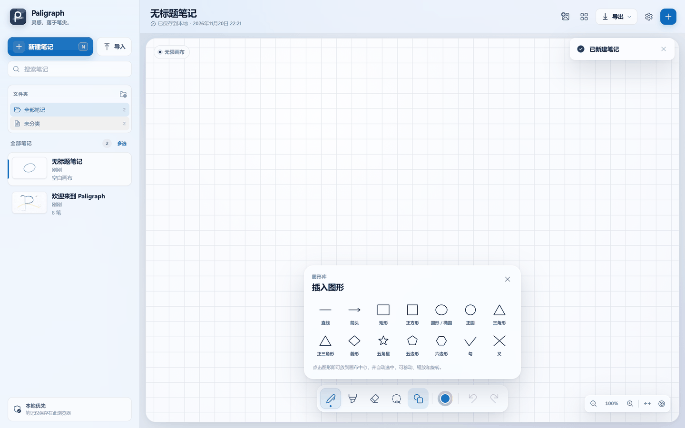

### 选择与编辑

- 套索圈选笔迹和画布图片，浮动工具条显示已选项目数量。
- 直接点击图片即可选中；拖动选区移动；拖动上方圆形手柄旋转；支持按钮旋转 90°。
- 复制、再制、删除、取消选择；`Ctrl/⌘ + C / V` 使用会话剪贴板，跨笔记也能粘贴图片。
- 撤销 / 重做覆盖绘制、擦除、图片插入、移动、旋转、复制粘贴与清空画布。
- 对象擦除、像素擦除、撤销历史均为有界操作，不会无限堆积。

### 画布图片

- 顶栏图片按钮可以向**当前已有笔记**插入 PNG、JPEG、WebP、GIF 或 SVG 图片；一次最多 12 张，每篇最多 40 张。
- 大图会按长边 2400 px 等比缩小并转为 WebP，SVG 保留矢量；图片以 data URL 随笔记保存在 IndexedDB。
- 图片位于背景之上、笔迹之下，可以像笔迹一样被套索选中、移动、自由旋转、90° 旋转、复制、再制或删除。
- 图片操作与笔迹操作共享同一套撤销历史；删除图片后可以撤销恢复。

### 笔记库、文件夹与多选

- 侧栏支持**嵌套文件夹**：新建、重命名、删除文件夹，点击文件夹筛选笔记。
- 删除文件夹时，其中的笔记和子文件夹内容会移动到上一级文件夹，不会删除笔记。
- 笔记列表支持**多选模式**：逐篇选择或全选，然后批量移动到文件夹或删除。
- 新建笔记会落在当前选中的文件夹；也可以在“未分类”和“全部笔记”之间切换。
- 每篇笔记右侧的三个点可以**移动到文件夹**或直接导出 PDF、Markdown、PNG、SVG、`.paligraph`。

### Markdown / Obsidian

- 导入一个或多个 `.md` 文件，或通过浏览器文件夹选择器导入整个 Obsidian 库。
- 支持拖放文件或文件夹。
- 保留 vault 相对路径和小型图片附件；`![[image.png]]`、`[[Note|label]]`、`==highlight==` 与 `> [!tip]` 等 Obsidian 语法会转成可读的阅读卡片。
- **按 Obsidian 原始目录层级创建嵌套文件夹**，笔记自动放入对应文件夹；重新导入同一路径会复用已有文件夹。
- **LaTeX 数学公式**通过 KaTeX 在阅读卡片中渲染：支持 `$...$`、`$$...$$`、`\(...\)` 和 `\[...\]`；代码块里的公式不会被误渲染。
- 原始 Markdown 无损保留，可在右侧源码抽屉中编辑。
- 每篇导入笔记会变成一张画布笔记：阅读卡片位于世界坐标中，可直接在其上绘图、圈画、批注。
- 导入笔记在笔记列表中生成**内容预览图**：包含标题、正文摘要；如果 Markdown 引用了 Vault 内的第一张图片，预览图会把它裁剪成封面。
- 阅读卡片内的图片支持点击放大预览（lightbox）；图片区域不会误触发绘图。
- 一次最多读取 240 篇 Markdown、80 张小图（单图 ≤ 1.6 MB，合计 ≤ 14 MB，单篇 Markdown ≤ 2.5 MB），超出部分会明确提示。
- 可以从导入对话框打开 `.paligraph` 可编辑笔记文件；它保留笔迹、画布图片、Markdown、背景和附件。
- 不会向 vault 写入任何内容；导入是单向复制。文件只在浏览器本地读取，不上传。

### 导出

- **Markdown**：保留原始 Markdown；如果笔记有笔迹或画布图片，会追加一张以 base64 内嵌的内容快照。
- **PDF**：A4 纵向，Markdown 使用系统字体排版后栅格化为页面，解决中文/日文字体嵌入问题；纯画布笔记导出笔迹与图片内容页。
- **PNG**：按内容边界导出平面图，包含背景、画布图片和笔迹，适合分享。
- **SVG**：矢量导出笔迹、图形、画布图片与背景；像素橡皮会转成 SVG mask，缩放不糊。
- **Paligraph 可编辑笔记（`.paligraph`）**：无损 JSON，包含 Markdown、笔迹、图片、背景和附件，可重新导入继续编辑。
- 也可以把导出的 PNG/SVG 再当作图片插入任意笔记。
- 顶栏导出当前笔记；笔记列表三个点可对任意笔记使用同一组导出格式。
- 导出模块、jsPDF 与 KaTeX 只在需要时加载，不进入首屏。

### 本地备份提醒

- 当前笔记超过 **100 笔**后，顶栏出现 `备份 · N 笔` 提示；每次会话首次超过阈值时还会弹出一条提醒。
- 点击顶栏提示即可直接导出当前笔记的 `.paligraph` 可编辑文件。
- 浏览器可能在清理站点数据时删除 IndexedDB 笔记，建议重要笔记定期导出本地备份。

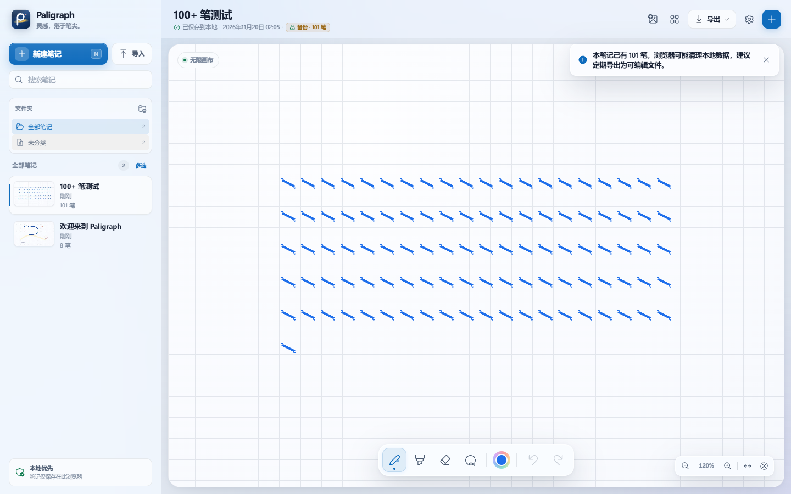

### 外观、背景与可访问性

- 浅色 / 深色 / 跟随系统三种主题，切换即时生效。
- 可选液态玻璃材质；关闭后使用实色 Fluent 层，降低 GPU 合成开销。
- 背景支持**空白、网格、圆点、横线、数学坐标轴**；线条支持实线/虚线；可调间距、透明度、色调。
- **数学坐标轴**背景显示带数字的刻度、原点 `O`、x/y 正方向箭头，以及贯穿画布的直线交叉网格；放大到 600% 时保持 **1 个世界单位为间隔**的小网格，每 5 个单位加粗并标注数字。随平移和缩放保持清晰，并会进入 PNG/PDF/SVG 导出。
- 每篇笔记独立背景，也可以把当前背景保存为新笔记默认值。

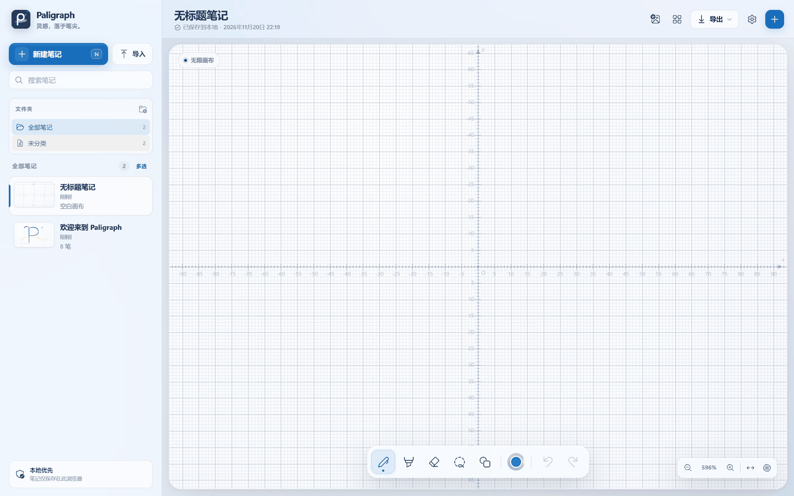
- 减少动态效果、画布提示、压感灵敏度、防误触、图形纠正与手写数学均可配置。
- 所有 UI 图标来自 [Microsoft Fluent UI System Icons](https://github.com/microsoft/fluentui-system-icons)（MIT）。

### PWA 安装

- 支持安装为独立窗口应用（Chrome/Edge 桌面与 Android），并支持 iOS Safari 添加到主屏幕。
- Chrome/Edge 检测到可安装时会捕获浏览器安装提示，并在侧栏显示低调的安装引导；也可以从 **设置 → 关于** 随时查看安装状态和步骤。
- 安装后使用独立窗口与图标启动，IndexedDB 笔记与浏览器版本互通。
- Service Worker 会预缓存应用外壳、所有按需模块、语言包、图标和 KaTeX 字体；安装后即使断网也能重新打开应用和已有笔记。
- 使用 `autoUpdate` 策略，新版本发布后下一次打开会更新缓存；首次安装缓存约 2.9 MB。
- 如果浏览器不支持自动安装，设置页会显示对应浏览器的手动安装步骤。

### 多语言与数据

- 内置简体中文、繁體中文、English、日本語；默认跟随浏览器语言。
- 语言文件为普通 JSON；支持从设置中导入自定义语言包，缺失键回退英语。
- 设置以版本化 `{ version, settings }` JSON 导入/导出，可复制、下载、恢复默认。
- 笔记、笔迹、画布图片和文件夹保存在 IndexedDB（文件夹使用独立 object store）；设置、语言偏好保存在 localStorage。
- 设置 JSON 不包含笔记内容（这是有意设计，避免把大量笔迹塞进偏好文件）。

### 存储占用

- 打开 **设置 → 数据与备份**，可以查看浏览器已用空间、配额与持久化状态。
- 按笔记数据拆分显示笔迹、画布图片、Markdown 文本/附件、笔记预览图、设置与语言包占用。
- 支持手动刷新；统计不离开浏览器。
- 笔记体积按序列化字段估算；浏览器统计包含应用缓存等其他同源数据，所以可能略大于笔记明细。

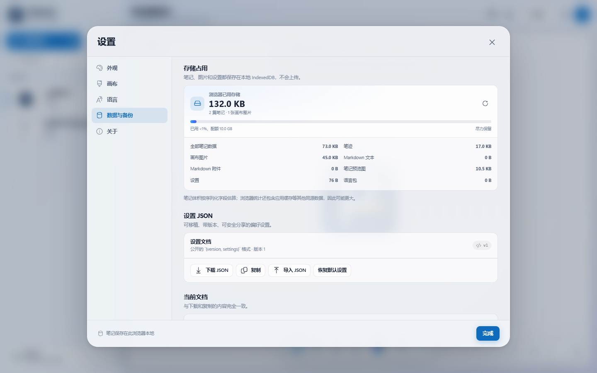

---

## 快速开始

要求 **Node.js ≥ 20.19**（CI 使用 Node 22）。

```bash
npm install
npm run dev        # http://localhost:4173
npm run typecheck  # TypeScript
npm test           # Vitest · 63 tests
npm run build      # 生产构建到 dist/
npm run preview    # 预览构建，端口 4173
```

开发服务器与预览服务器都固定使用 `4173`，方便 QA 脚本复用。

### 生产构建与 GitHub Pages

仓库包含 [`.github/workflows/deploy.yml`](.github/workflows/deploy.yml)：

1. push 到 `main`（或在 Actions 页手动运行 `workflow_dispatch`）。
2. 工作流依次执行 `npm ci` → `typecheck` → `test` → `build`。
3. 构建时注入 `GITHUB_ACTIONS=true`，Vite 自动把 base path 切换为 `/Paligraph-Canvas/`，HTML、图标、manifest、语言文件和 Service Worker scope 全部适配项目页子路径。
4. `vite-plugin-pwa` 生成 `sw.js` 与 Workbox 预缓存清单；首次访问后即可离线打开。
5. 通过 `actions/configure-pages`（带 `enablement: true`）、`upload-pages-artifact` 和 `deploy-pages` 发布。

首次进入仓库时，请在 **Settings → Pages → Build and deployment** 将 Source 设为 **GitHub Actions**。工作流里的 `enablement: true` 也会尝试在全新仓库上自动启用 Pages。

部署地址：<https://whwdzg.github.io/Paligraph-Canvas/>

本地模拟 Pages 子路径（可选）：

```bash
# 在 Windows PowerShell 中
$env:GITHUB_ACTIONS='true'; npm run build
# 把 dist/ 作为 Paligraph-Canvas/ 子目录放入一个静态服务器根目录
```

---

## 使用说明

### 工具栏

| 工具 | 操作 |
| --- | --- |
| 钢笔 / 荧光笔 / 橡皮 | 点击工具按钮绘制；再次点击已选中的工具打开选项面板 |
| 颜色圆环 | 打开当前工具的配色与尺寸选项 |
| 撤销 / 重做 | 底部工具栏按钮，或 `Ctrl/⌘ + Z`、`Ctrl/⌘ + Shift + Z` |
| 选择 | 套索圈选笔迹/图片；拖动选区移动，拖动圆形手柄旋转 |
| 文件夹栏 | 新建/重命名/删除嵌套文件夹，点击筛选笔记 |
| 多选 | 进入多选模式，逐篇或全选后批量移动、删除 |
| 笔记三个点 | 移动到文件夹，或导出 PDF/Markdown/PNG/SVG/可编辑笔记 |
| 图片按钮（顶栏） | 向当前笔记插入 PNG/JPG/WebP/GIF/SVG |
| 背景按钮（顶栏网格） | 打开当前笔记的背景面板 |
| 导出（顶栏） | PDF、Markdown、PNG、SVG 或 `.paligraph` 可编辑笔记 |
| 设置（顶栏） | 外观、画布、语言、数据、关于 |

### 快捷键

| 快捷键 | 功能 |
| --- | --- |
| `P` / `H` / `E` / `L` | 钢笔 / 荧光笔 / 橡皮 / 选择 |
| `Ctrl/⌘ + Z` | 撤销 |
| `Ctrl/⌘ + Shift + Z` 或 `Ctrl/⌘ + Y` | 重做 |
| `Ctrl/⌘ + C` / `V` | 复制 / 粘贴选区 |
| `Ctrl/⌘ + D` | 再制选区 |
| `Delete` / `Backspace` | 删除选区 |
| `0` | 重置视图 |
| `+` / `-` | 放大 / 缩小 |
| `Space + 拖动` | 平移画布 |
| `Ctrl/⌘ + 滚轮` | 以指针为中心缩放 |
| `N` | 新建笔记 |
| 画完图形后按住 | 停顿约 0.62 秒纠正为基本图形 |
| 套索选中后点击数学按钮 | 识别、修正并求解所选数学公式 |

### 触控与手写笔

- 单指绘制；双指长按约 260 ms 后移动/捏合，进入画布导航。
- 双指快速触碰会被识别为误触，不会移动画布或留下笔迹。
- 手写笔靠近后，触摸会被短时间忽略（手掌防误触可关闭）。
- 手写笔侧键在支持 Pointer Events 的浏览器中会临时切换为按笔迹擦。

---

## 设置 JSON

公共格式来自 [`src/config/default-settings.json`](src/config/default-settings.json)：

```json
{
  "version": 1,
  "settings": {
    "theme": "system",
    "language": "system",
    "liquidGlass": true,
    "shapeRecognition": true,
    "mathRecognition": true,
    "penVariant": "pen",
    "penColor": "#1f6feb",
    "penSize": 4,
    "highlighterColor": "#ffd60a",
    "highlighterSize": 22,
    "highlighterMode": "free",
    "eraserMode": "stroke",
    "defaultBackground": {
      "pattern": "grid",
      "lineStyle": "solid",
      "spacing": 32,
      "opacity": 0.14,
      "color": ""
    }
  }
}
```

导入时可以只提供部分字段；未知字段忽略，数值会夹取到安全范围，颜色字段只接受 `#rrggbb`。版本高于当前支持版本会拒绝导入。

## 语言包

在 **设置 → 语言 → 导入语言包** 选择 JSON 文件：

```json
{
  "code": "pt-BR",
  "label": "Português",
  "nativeLabel": "Português (Brasil)",
  "translations": {
    "app.tagline": "Ideias, em tinta.",
    "sidebar.newNote": "Nova nota"
  }
}
```

也可以直接使用扁平的 key/value 字典；文件名会作为语言代码。`code` 必须匹配 `^[a-z]{2,3}(-[A-Za-z0-9]{2,8})?$`。导入的包保存在 localStorage，缺失键自动回退英语。

内置语言文件在 [`public/locales/`](public/locales/)，欢迎提交新的翻译 PR。

---

## 设计与实现

### 视觉

- **Fluent Design Sun Valley**：Mica 式背景、Fluent 强调色、Acrylic 层级、圆角与克制的阴影。
- **Apple Notes 式工具逻辑**：底部悬浮工具栏、点击工具打开上下文选项、套索后浮动操作条。
- 可选 **liquid glass**：半透明、模糊、饱和度与高光边框；关闭后完全退化为实色 Fluent 表面。
- 侧栏、顶栏、工具条、对话框和提示层共用一套 spacing / radius / shadow token（[`src/styles/tokens.css`](src/styles/tokens.css)）。
- 应用图标为手绘的 “P” 墨迹 + 金色荧光笔 + 珊瑚色笔点，源文件 [`public/icons/icon.svg`](public/icons/icon.svg)，可运行 `npm run icons` 重新生成各尺寸 PNG（需要 Edge/Chrome）。

### 画布架构

`DrawingSurface` 使用四个独立 Canvas 层：

1. **background**：纸张颜色与网格/点阵/横线图案，屏幕空间绘制，保证任意缩放下清晰。
2. **ink**：已提交笔迹；只渲染与视口相交的笔画。
3. **live**：当前笔迹或选择变换预览；只重绘这一层。
4. **overlay**：套索路径、选区边框、旋转手柄。

像素橡皮通过 `destination-out` 合成，作为一条向量擦除笔迹写入文档，因此撤销/重做、导出和重新打开后都能重放。按笔迹擦在指针抬起时一次提交被擦除的笔画集合。所有渲染通过 `requestAnimationFrame` 合并，指针移动期间不写 IndexedDB。

### 性能策略

- 首屏只加载 React、Canvas UI 与应用状态；Markdown 渲染器、Obsidian 扫描器、jsPDF 都是按需 chunk。
- 当前构建首屏 JS gzip 约 **133 KB**，CSS gzip 约 **16 KB**，语言包约 **5 KB**；手写数学识别器、Math.js 数学引擎（约 192 KB gzip）、Markdown + KaTeX 渲染器（约 100 KB gzip，KaTeX CSS 约 8 KB gzip）、SVG/PNG 编码与导出模块（jsPDF 约 121 KB gzip）都在需要时才下载。
- PWA 首次安装的 Workbox 预缓存约 **2.9 MB**，包含所有按需模块、字体与语言包；之后由 `autoUpdate` 在后台更新。
- 画布图片使用解码缓存（最多 24 张），离屏/缩略图导出按需解码；插入时大图会先缩小，避免把原始相机照片长期留在内存。
- 所有 Canvas 层按 `devicePixelRatio` 渲染，但根据视口面积与设备内存限制像素预算；大屏不会直接使用 2× 全屏位图，避免四层画布把内存放大到不可控。
- 只绘制视口内的笔画；输入点会做最小距离过滤、结束时 RDP 简化，避免存储冗余点。
- 缩略图使用 WebP 矢量重绘，保存时延迟生成；不保存整张画布位图。
- 自动保存有 650–700 ms 防抖；页面隐藏时尽力刷新。
- 液态玻璃可关闭以减少 backdrop-filter 合成开销；`prefers-reduced-motion` 与设置中的“减少动态效果”都会生效。

### 数据与隐私

- 笔记文档保存在 IndexedDB 数据库 `paligraph-canvas` 的 `notes` object store。
- 设置保存在 localStorage 的 `paligraph-settings`（Zustand persist）。
- 语言包保存在 `paligraph-language-packs`。
- 没有任何遥测、账号或云端调用；导入文件不会离开浏览器。
- 清除站点数据会删除本地笔记。设置 JSON、`.paligraph`、Markdown/PDF/PNG/SVG 导出是当前的迁移手段。

---

## 项目结构

```text
Paligraph-Canvas/
├─ .github/workflows/deploy.yml    GitHub Pages 部署
├─ public/
│  ├─ icons/                       应用图标与 favicon 源文件/PNG
│  ├─ locales/                     内置语言包 + manifest.json
│  └─ manifest.webmanifest         PWA manifest
├─ scripts/                        图标生成、QA、README 截图脚本
├─ src/
│  ├─ components/
│  │  ├─ canvas/DrawingSurface.tsx Canvas 交互与渲染调度
│  │  ├─ editor/                  工具栏、选项、导入、Markdown 源码
│  │  ├─ settings/                设置对话框
│  │  ├─ sidebar/                 笔记库、文件夹、多选
│  │  ├─ pwa/                     PWA 安装提示与引导卡片
│  │  └─ common/                  Modal、Switch、Slider 等
│  ├─ config/                     默认设置与色板
│  ├─ hooks/                      笔记持久化、PWA 安装、主题、提示
│  ├─ i18n/                       运行时 i18n
│  ├─ lib/                        几何、笔迹、渲染、存储、导出
│  │  ├─ math/solver.ts            一元一次方程与四则运算
│  │  ├─ math/recognizer.ts        本地手写数字/符号识别
│  │  ├─ media.ts                  画布图片、SVG/位图导入与解码缓存
│  │  ├─ editable.ts               `.paligraph` 无损可编辑格式
│  │  ├─ storageUsage.ts           存储占用估算与分类
│  │  ├─ folders.ts                文件夹树、路径与批量整理
│  │  ├─ backup.ts                 笔数阈值与本地备份提醒
│  │  ├─ shapes.ts                 基本图形识别与吸附
│  │  └─ thumbnail.ts              Markdown/笔迹/图片内容预览图
│  ├─ state/                      Zustand 设置 store
│  └─ styles/                     design tokens 与响应式样式
├─ index.html                     首屏主题/locale 预取 + 静态度量
└─ vite.config.ts                 base path、手动拆包、PWA/Service Worker、测试
```

---

## 验证

```bash
npm run typecheck
npm test
npm run build
```

当前验证结果：**63 个单元测试通过**，TypeScript 严格模式无错误，生产构建成功。

浏览器 QA 需要先运行 `npm run preview`，并使用本地 Edge/Chrome：

```bash
npm run qa              # 首次加载与基础 DOM
npm run qa:interactions # 绘图、套索、移动/旋转、设置、导入、PDF
npm run qa:touch        # CDP 双指长按平移、捏合缩放、快速误触
npm run qa:features     # 荧光笔直线、橡皮、复制粘贴、设置 JSON、语言
npm run qa:shapes-math  # 选择识别、图形吸附、高级数学与竖式
npm run qa:shapes-library # 图形库插入与坐标轴背景
npm run qa:previews     # Markdown / Obsidian 内容预览图
npm run qa:storage      # 设置中的存储占用读数和明细
npm run qa:folders      # 文件夹、多选移动/删除、笔记菜单导出
npm run qa:latex        # Markdown/Obsidian LaTeX 渲染
npm run qa:pwa          # 安装提示、Service Worker、离线启动
npm run qa:backup       # 超过 100 笔的备份提醒与可编辑文件导出
npm run qa:images       # 插入图片、选中、旋转、复制、删除、撤销
npm run qa:export       # PNG / SVG / .paligraph 导出与再导入
node scripts/qa-assets.mjs  # Obsidian 附件导入与图片 lightbox
node scripts/qa-pdf.mjs     # 中文 PDF 导出
```

`playwright-core` 不下载浏览器，而是复用本机已安装的 Edge/Chrome；可通过 `CHROME_PATH` 指定可执行文件。CI 只运行单元测试与构建，不运行浏览器 QA。

---

## 已知限制

- PDF 页面是 Canvas 栅格图，文字不可选中/搜索；这是为了在客户端可靠显示中文、日文而不引入大型字体文件。
- 导入 Markdown 的图片附件会内联为 data URL；单次导入有明确上限。PDF 中 Markdown 图片显示为占位文字，笔迹会输出到单独的“笔迹批注”页。
- 导入的笔记是可编辑的阅读卡片，不是完整的 Obsidian 渲染器：嵌入图谱、Dataview、Canvas 等插件语法不会执行。
- 目前没有云同步、协作或多设备合并；数据属于当前浏览器配置文件。
- “双指长按”是故意设计的防误触机制；首次使用可能需要一两次适应。
- 手写数学使用本地几何 + 字体骨架模板识别，不是神经网络 OCR。支持数字、常用变量、四则运算、幂、`Σ`、`π`、`√` 等符号；方程组、求导、求和等复杂结构仍可能需要手动修正。求解端支持线性方程组、符号求导、有限求和、对数/指数和单变量方程数值根，不代表完整的计算机代数系统。
- Markdown 数学公式使用 KaTeX 的常用 LaTeX 子集；少数非 KaTeX 命令会显示错误标记。KaTeX 只用于阅读卡片，PDF/Markdown 导出保留原始 LaTeX 源码，不会把公式重新排版成数学字体。
- 导入 Obsidian 文件夹时，选中的 vault 根文件夹也会保留为顶层文件夹；若要合并到现有结构，可在导入后移动笔记。
- 基本图形纠正覆盖直线、矩形、正方形、正圆、椭圆、三角形、正三角形、菱形、五角星、勾、叉；潦草的五角星、勾、叉可能需要重画或从图形库插入。不会自动纠正复杂图标或手写汉字。
- 超大笔记（数千笔迹）在低端移动设备上仍可能需要降低缩放或关闭液态玻璃。DPR 预算会优先保证交互流畅。
- 笔记列表内容预览图只内联 Vault 内的小图（data URL）；外链图片不会抓取，以保持本地优先和画布安全。
- PNG/SVG 导出的是**画布内容**（背景、图片、笔迹）；Markdown 阅读卡片的正文排版请使用 PDF 或 Markdown 导出，避免把 HTML 文本硬塞进 SVG。
- SVG 是干净的矢量近似：铅笔/蜡笔的颗粒纹理、毛笔的复杂压力轮廓不会一比一保留；像素橡皮会以 mask 表达。需要完全一致的像素效果请导出 PNG。
- 画布图片以 data URL 存储，单篇图片过多或过大仍会占用浏览器配额；插入时会限张数并压缩位图。动画 GIF 只保留第一帧。
- 设置里的存储明细是估算值，不能替代浏览器 DevTools 的精确配额报告；清理站点数据会连同所有笔记一起删除。
- PWA 离线缓存与应用更新依赖 Service Worker；首次访问或清理站点数据后需要联网重新加载一次。安装引导只在支持安装的浏览器/设备上显示。
- 当前 PWA 使用自动更新，没有“立即更新”提示；若需要强制获取最新版本，可关闭页面后重新打开或清除站点缓存。

---

## License

GNU General Public License v3.0 or later. See [LICENSE](LICENSE).

图标来自 Microsoft Fluent UI System Icons（MIT）；应用图标、截图与文稿由本项目创作。
